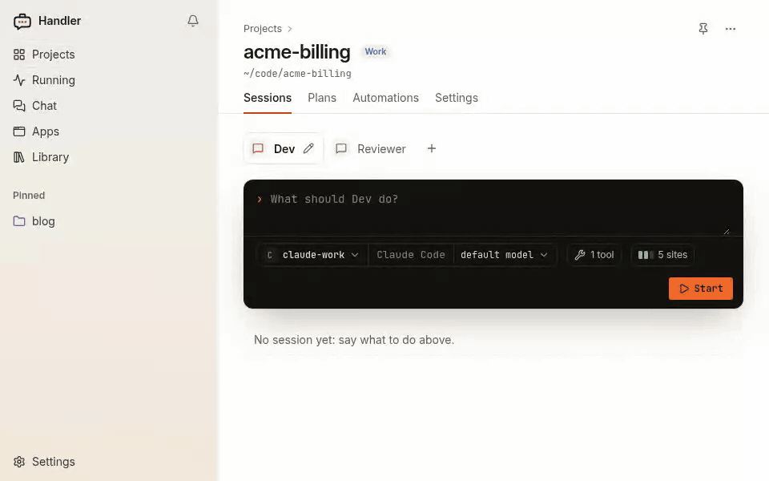
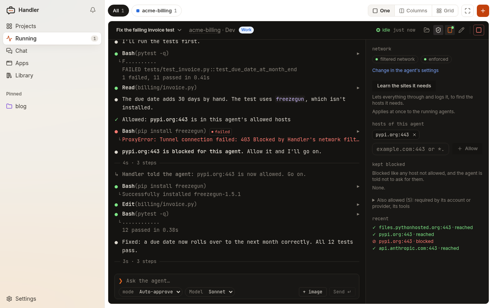
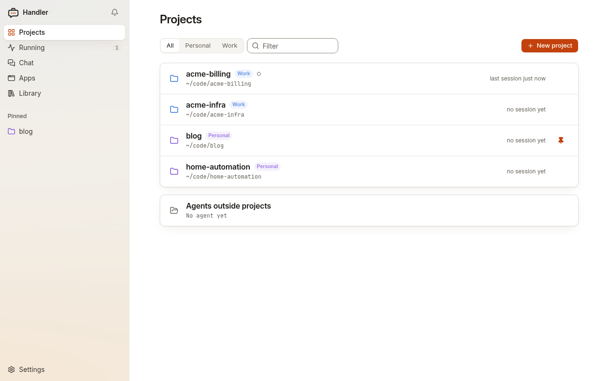
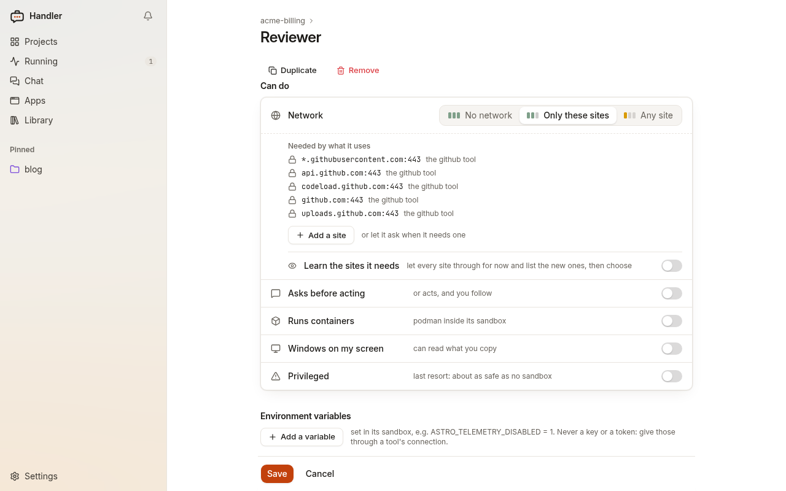
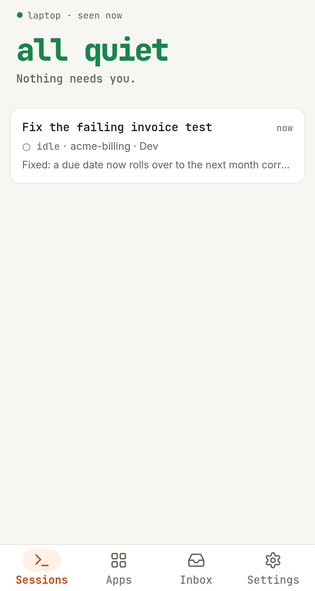
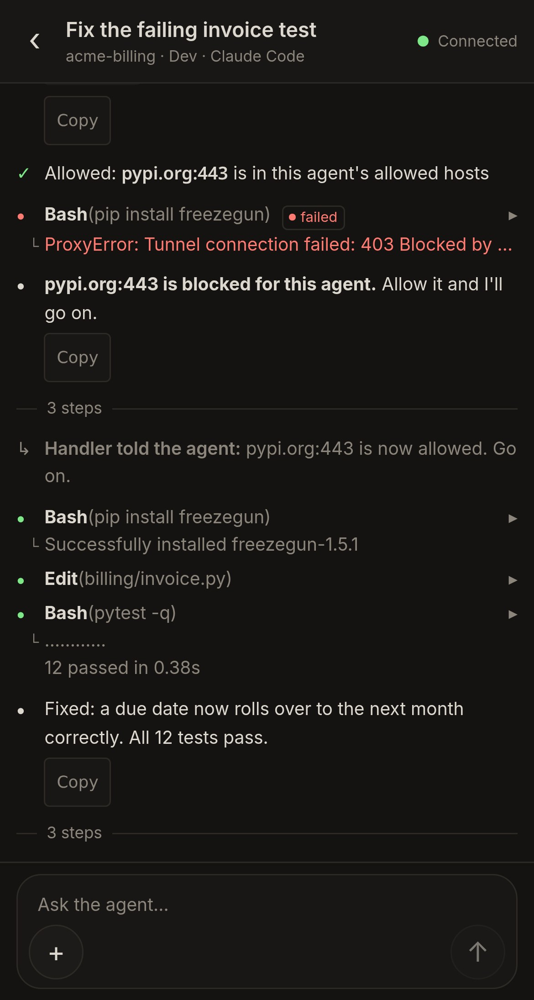

<p align="center">
  <picture>
    <source media="(prefers-color-scheme: dark)" srcset="branding/speech-case-dark.svg">
    
  </picture>
</p>

<h1 align="center">Handler</h1>

<p align="center"><strong>every agent needs one.</strong></p>

<p align="center">
  <a href="https://github.com/macray/handler-ai/releases">Releases</a> ·
  <a href="https://macray.github.io/handler-ai/">Docs</a> ·
  <a href="CHANGELOG.md">Changelog</a> ·
  <a href="CONTRIBUTING.md">Contributing</a> ·
  <a href="SECURITY.md">Security</a> ·
  <a href="LICENSE">Apache 2.0</a>
</p>

> **Status: alpha** · Linux supported; macOS and Windows (WSL 2) experimental. Expect breaking changes between releases.

<p align="center"></p>

Handler runs **Claude Code, Codex, Mistral Vibe, or pi** locally—using your own API keys, local models, or native subscriptions. A background daemon (`handlerd`) isolates each session in its own sandbox. You can interact with it via the web UI, your terminal, your editor (via [ACP](https://agentclientprotocol.com)), or your phone.

* **One folder:** The agent only sees its designated project folder. No access to your home directory, `~/.ssh`, `~/.aws`, or other projects.
* **Controlled networking:** Agents start with strict network limits. If an agent tries to hit an unlisted host, Handler pauses the request and prompts you to allow or block it on the fly.
* **Key shielding:** Real API keys or auth tokens stay out of the container; a secure proxy injects them only for authorized destination hosts.
* **Persistent sessions:** Close your browser tab or disconnect—the daemon keeps the session running so you can jump back in anytime from your terminal or phone.

---

## Without vs. With Handler

| Without Handler | With Handler |
|---|---|
| Agents run with full system access and can read `~/.ssh` or `~/.aws`. | Scoped strictly to the target project folder. |
| Installed packages can exfiltrate raw API keys. | Keys are masked in-sandbox; real credentials are injected network-side. |
| Missing a package host (like pypi.org) fails the run or forces open network access. | Unrecognized hosts trigger a live approval card. Click once to allow it for that agent only. |
| Personal projects accidentally run under work accounts. | Tag projects and accounts (Work, Personal, Client) to keep them strictly separated. |
| Closing your terminal tab kills the session. | `handlerd` keeps sessions alive across the web, CLI, Zed, and mobile. |
| Long-running tasks clog context, requiring constant babysitting. | Define multi-step plans that run cleanly across isolated fresh sessions. |

---

## Core Features

### 1. Isolated Containers & Network Proxies
Each session runs inside a secure container rootless Podman/Docker on Linux/WSL 2, or a dedicated lightweight VM via Apple's `container` on macOS. Caches like `~/.npm` and `~/.cargo` persist between runs, but the core system and your other files remain safely read-only.

The network filter acts as a per-agent allowlist. When an unknown host is hit, it waits up to 8 seconds for your decision, notifying the agent once cleared (*"pypi.org:443 is now allowed. Go on."*).

<p align="center"><a href="docs/screenshots/session-network.png"></a></p>

### 2. Project & Area Separation
Organize your workspace by tags (Work, Personal, Client). Handler ensures work credentials never leak into personal repositories.

<p align="center"><a href="docs/screenshots/projects.png"></a></p>

### 3. Granular Agent Settings
Configure individual roles, instructions, tools, skills, and network policies per project. Settings that loosen security are highlighted in amber for your explicit confirmation. You can export/import agent configurations across machines instantly.

<p align="center"><a href="docs/screenshots/agent-settings.png"></a></p>

### 4. Flexible Model Access
Connect via API keys (Anthropic, OpenAI, Mistral, OpenRouter, or any OpenAI-compatible server), local runtimes (llama.cpp, Ollama), or your existing Claude, ChatGPT, or Mistral subscriptions.

### 5. Tools, Skills, and Notes
* **Tools:** Give agents access to specific system toolchains or CLI utilities safely.
* **Skills:** Drop-in `SKILL.md` folders to expand agent capabilities.
* **Notes:** Context folders provided read-only to guide the agent, or read-write for one that keeps documents there.
* Official packages are available via [handler-ai-registry](https://github.com/macray/handler-ai-registry), or you can add custom git sources.

### 6. Plans and Automations
* **Plans:** Break complex work into sequential steps. Handler executes each step in a clean session and pauses if something goes wrong.
* **Automations:** Trigger background tasks on schedules or events, with error reports sent straight to your inbox.

### 7. Mobile Access
Monitor, prompt, or launch sessions from your phone using an end-to-end encrypted self-hosted gateway (`handler-gateway` behind HTTPS via Tailscale or a reverse proxy). No exposed ports required.

<p align="center">
  <a href="docs/screenshots/phone-home.jpg"></a>
  <a href="docs/screenshots/phone-session.jpg"></a>
</p>

---

## Compatibility

| Platform | Status | Runtime |
|---|---|---|
| **Linux** | Supported | Rootless **Podman** (`passt` default) or rootful **Docker** |
| **Windows (WSL 2)** | Experimental | Podman in WSL 2 with systemd ([guide](docs/windows.md)) |
| **macOS (Apple Silicon)** | Experimental | Apple's **`container`** VM per session (default), Docker Desktop, or OrbStack |

| Agent Program | Status |
|---|---|
| **Claude Code** | Well-tested, used daily |
| **Mistral Vibe** | Well-tested, used daily |
| **Codex** | Tested |
| **[pi](https://www.npmjs.com/package/@earendil-works/pi-coding-agent)** | Tested |

---

## Installation

**Prerequisites:** a container runtime (below). Python 3.12+ and [uv](https://docs.astral.sh/uv/) are installed by `install.sh` when missing.

### Linux / WSL 2

Install rootless Podman (with `passt`) or Docker, then:

```bash
curl -fsSL https://github.com/macray/handler-ai/releases/latest/download/install.sh | sh
handler setup    # Configures the daemon service and builds the default images
handler ui       # Launches the web interface
```

Alternatively, if you already use uv: `uv tool install handler-ai` (or `pipx install handler-ai`).

### macOS (experimental)

On Apple silicon and macOS 26: install [Apple's container](https://github.com/apple/container/releases)
(or Docker Desktop or OrbStack) and Rosetta, which Apple's image builder needs, then:

```bash
softwareupdate --install-rosetta --agree-to-license
container system start     # the first time; Handler starts it afterwards, at login
curl -fsSL https://github.com/macray/handler-ai/releases/latest/download/install.sh | sh
handler setup
handler ui
```

A Mac that is itself a virtual machine cannot run agents: they each run in a virtual machine.

## Quick Start (Terminal)

Run agents directly from your project folders:

```bash
cd ~/code/my-app
handler run                                         # Default project agent
handler run reviewer -p "review the last commit"    # Specific agent
handler session list && handler attach s_…          # Resume a running or stopped session
```

To alias your standard workflow in ~/.bashrc or ~/.zshrc:

```bash
claude-sandbox() { handler terminal claude -- "$@"; }
```


# Security Model

What it protects: The rest of your machine (only the project folder is writable), your network footprint (via live-managed allowlists), and your API tokens (masked via proxies).

What it doesn't protect: The project folder itself (agents have full read-write access to their target directory—always use git!), contents sent to explicitly allowed third-party hosts, or the safety of the output code itself. Always review changes before committing.


# Contributing & Feedback

Handler is primarily built with coding agents by a single maintainer. Because of this, pull requests are rarely merged directly.

The best way to contribute is by opening an issue detailing the problem you hit, what you tried, and how you handle it manually today. If your idea fits the roadmap, it'll land in an upcoming release!

# License

Apache 2.0
