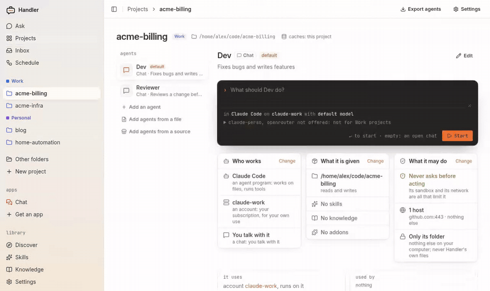
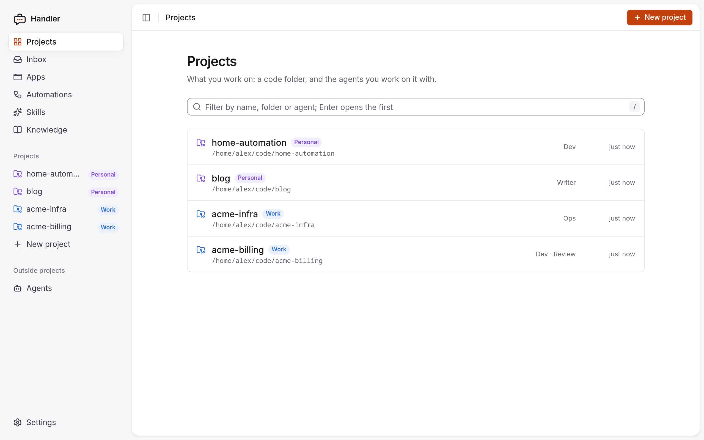
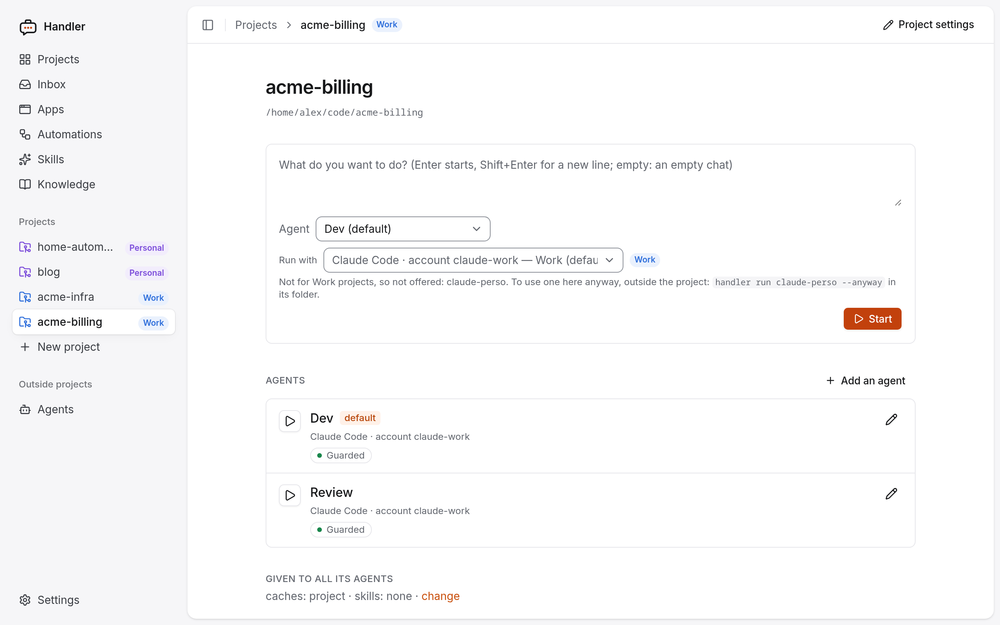
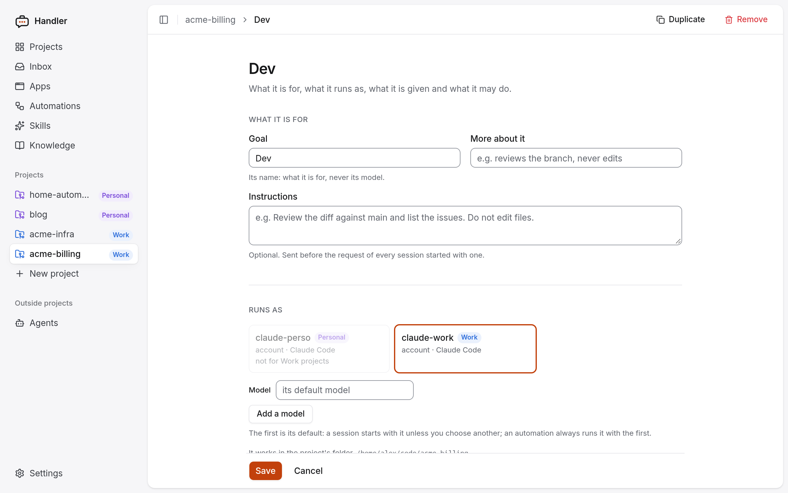
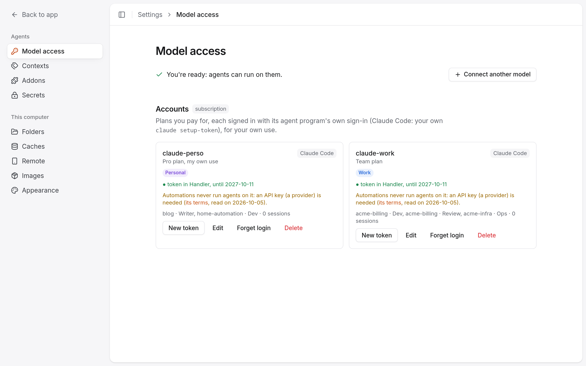
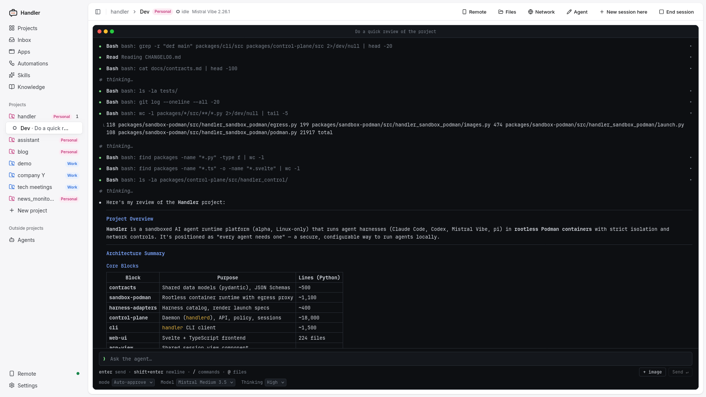
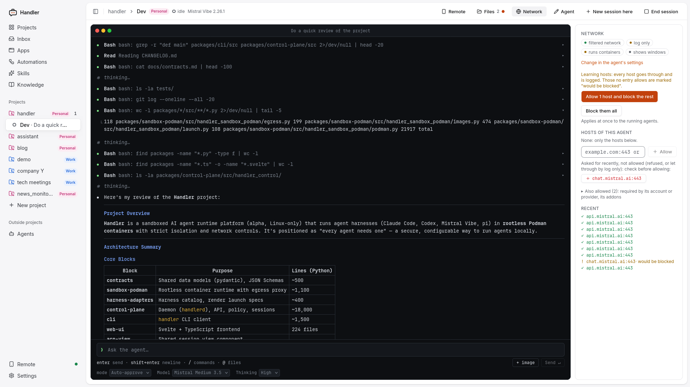
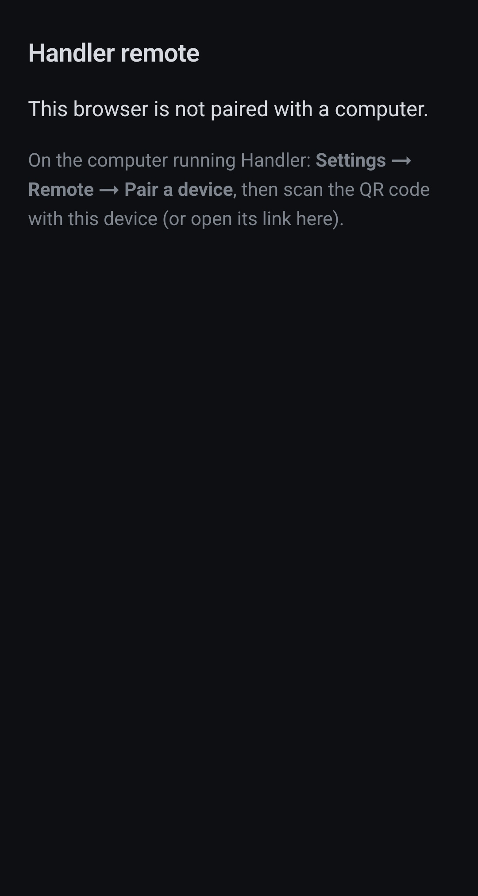
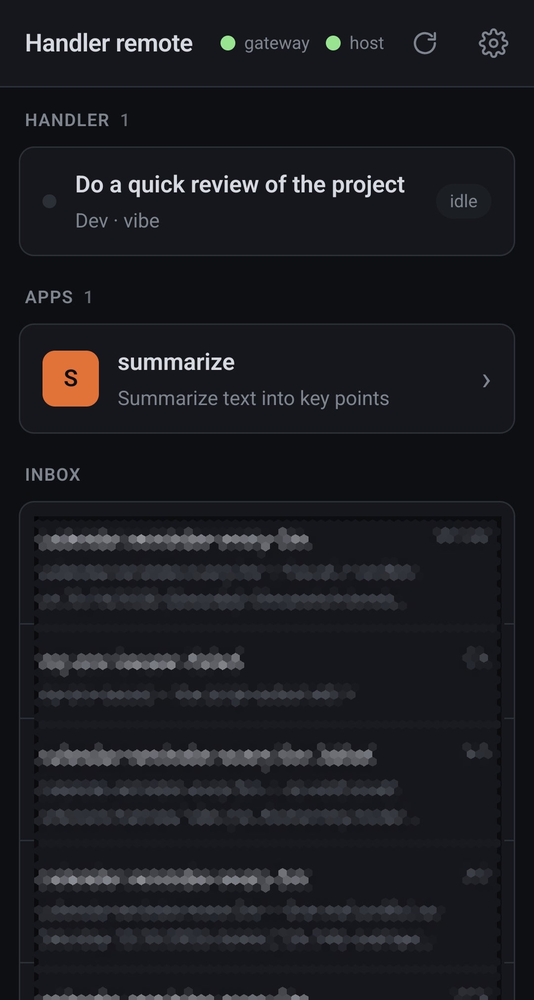
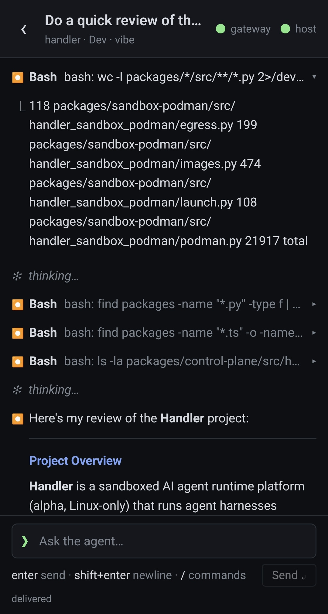

<p align="center">
  <picture>
    <source media="(prefers-color-scheme: dark)" srcset="branding/speech-case-dark.svg">
    
  </picture>
</p>

<h1 align="center">Handler</h1>

<p align="center"><strong>Handler</strong>: every agent needs one.</p>

<p align="center">Run coding agents in containers on your Linux machine.<br>Each agent sees only its project folder and reaches only the hosts you allow.</p>

Handler runs Claude Code, Codex, Mistral Vibe and pi in rootless Podman containers. A daemon
keeps the sessions running, and you use them from a web UI, the terminal, your editor (over
[ACP](https://agentclientprotocol.com), the Agent Client Protocol) or your phone.

<p align="center"></p>

> **Status: alpha.** Linux only. It is used every day by its author, but has few other users so
> far. Expect rough edges, and features that may still change. An update converts your settings
> when their format changes; the [changelog](CHANGELOG.md) says what changed.

| Harness | Status |
|---|---|
| Claude Code | well tested |
| Mistral Vibe | well tested |
| Codex | little tested |
| [pi](https://www.npmjs.com/package/@earendil-works/pi-coding-agent) | little tested |

## What it does

- **One container per session.** The project folder is mounted read-write at the same path. Your
  home, `~/.ssh`, `~/.aws` and your other projects are not mounted.
- **A network filter per agent.** Choose *none*, *filtered* (only the hosts you allow) or *open*.
  *Learn hosts* lets everything through for a while and lists what would have been blocked.
  Changes apply while the agent works.
- **API keys stay outside.** For a Claude Code token or a provider's API key, the agent only gets
  a stand-in. The network filter puts the real value into requests to that key's own hosts. Other
  secrets can be read by the agent (see [Limitations](#limitations)).
- **Sessions survive the browser tab.** `handlerd` keeps each session running. Attach to it from
  the web UI, the terminal (`handler attach`), Zed (`handler acp`) or a phone.
- **Any model access.** An API key, OpenRouter, a local llama.cpp or Ollama, or your own Claude,
  ChatGPT or Mistral subscription for your own interactive use.
- **Work and personal kept apart.** Tag projects, accounts and providers with a context (Work,
  Personal, a client). A work account then never runs on a personal project, and the other way
  round.
- **Optional extras:** addons (a Playwright browser, the Shopify CLI), skills, small web apps
  written by an agent, automations (on a schedule or when a session ends), and phone access
  through an end-to-end encrypted gateway that you host.

## How it compares

Other tools sandbox coding agents too. Here is where Handler differs, as of October 2026. Check
each project's own docs for the details.

| | Handler | Claude Code's `/sandbox`, Codex's sandbox | Docker Sandboxes (`sbx`) | A devcontainer or VM you set up |
|---|---|---|---|---|
| What is isolated | the whole agent program | the commands it runs (the agent itself runs on your machine) | the whole agent program | the whole agent program |
| Isolation | rootless container (shares your kernel) | OS sandbox (bubblewrap, Landlock, Seatbelt) | microVM (its own kernel): stronger | as you set it up |
| Harnesses | Claude Code, Codex, Vibe, pi | one each | several | any |
| Network | per-agent allow-list, changed live, *Learn hosts* | allow-list | deny by default, allow-list | as you set it up |
| API keys | stand-in in the sandbox | in the agent's environment | injected by a proxy | in the environment |
| Sessions | kept by a daemon, from browser, terminal, editor, phone | the harness's own | the harness's own | the harness's own |
| Platforms | Linux | Linux, macOS (Windows partly) | Linux, macOS, Windows | any |

Pick Handler if you are on Linux, use more than one harness, and want one place to see and
control what every agent reaches. Pick a microVM if you need the stronger isolation.

## Install

**You need:** Linux with rootless Podman, `passt` and a systemd user session. Plan for about 3 GB
of disk: the images are built on your machine. The first `handler setup` downloads and builds them,
which can take from a few minutes to half an hour, depending on your connection.

```bash
uv tool install handler-ai   # or: pipx install handler-ai
handler setup   # starts handlerd as a user service, checks this machine, builds the images
handler ui      # opens the web UI
```

Without [uv](https://docs.astral.sh/uv/), `install.sh` installs it, then Handler with it, in
`~/.local/bin`. It changes nothing else; read it first if you prefer: it is attached to each
[release](https://github.com/macray/handler-ai/releases).

```bash
curl -fsSL https://github.com/macray/handler-ai/releases/latest/download/install.sh | sh
```

To update: `uv tool upgrade handler-ai`. `handler setup` says what your machine is missing and can be run
again at any time.

To build from a checkout instead: [development](docs/dev/development.md).

## First session

1. **Connect a model.** In the web UI, go to Settings → Model access → *Connect a model*:
   - **An API key**: Anthropic, OpenAI, OpenRouter, or a local llama.cpp or Ollama.
   - **Claude Pro or Max**: run `claude setup-token` yourself (Anthropic's own sign-in) and paste
     the token it prints. Handler never signs in for you. A subscription is used only for sessions
     you start and follow; automations need an API key.
   - **ChatGPT or Mistral**: Handler opens the harness's own login in a terminal window.
2. **Create a project.** Click *New project* and pick a folder. Choose how its first agent starts:
   *Locked down* (no network, asks before acting), *Guarded* (allowed hosts only; the default) or
   *Open* (any host).
3. **Ask.** Type a request and press Enter. The session keeps running after you close the tab.

Step by step: [getting started](docs/user/getting-started.md).

## From the terminal

The current folder decides which project's agent runs:

```bash
cd ~/code/my-app
handler run                                    # the project's default agent
handler run reviewer -p "review the last commit"   # the agent named reviewer
handler session list && handler attach s_…     # back to a session, running or stopped
```

To keep typing `claude` as you do today, but inside a container and on the account you choose,
put a shell function in `~/.bashrc`. It works for Claude Code and Mistral Vibe:

```bash
claude() { handler terminal claude-perso -- "$@"; }
```

More: [`handler terminal`](docs/user/cli/terminal.md), [every command](docs/user/cli/index.md).

## Screenshots

<table>
  <tr>
    <td width="50%"><a href="docs/user/screenshots/projects.png"></a><br>Projects, tagged by context (Work, Personal).</td>
    <td width="50%"><a href="docs/user/screenshots/project.png"></a><br>A project: its agents, and a new session. An account that is not set up for Work is not offered.</td>
  </tr>
  <tr>
    <td><a href="docs/user/screenshots/agent-settings.png"></a><br>An agent's settings: goal, instructions, the account it runs on.</td>
    <td><a href="docs/user/screenshots/model-access.png"></a><br>Model access: accounts and providers, each for a context.</td>
  </tr>
  <tr>
    <td><a href="docs/user/screenshots/session-terminal.png"></a><br>A session: the agent's tool calls and answer, its mode, model and thinking level.</td>
    <td><a href="docs/user/screenshots/session-network.png"></a><br>The network panel while learning hosts: what would have been blocked, allowed in one click.</td>
  </tr>
  <tr>
    <td colspan="2" align="center">
      <a href="docs/user/screenshots/gateway-not-pair.jpg"></a>
      <a href="docs/user/screenshots/gateway-homepage.jpg"></a>
      <a href="docs/user/screenshots/gateway-terminal.jpg"></a>
      <br>On a phone, through the remote gateway: before pairing, the home page (sessions, apps, inbox), a session.
    </td>
  </tr>
</table>

## How it works

```
 web UI · handler CLI · editor (handler acp) · phone
              │  HTTP + WebSocket (ACP)
              ▼
          handlerd ── projects, agents, sessions; checks every message to and from the agent
              │
              ▼
   ┌──────────────── rootless Podman ─────────────────┐
   │  agent container            network filter       │
   │  Claude Code / Codex / …  ──► allowed hosts only │
   │  project folder (rw), nothing else               │
   └──────────────────────────────────────────────────┘
```

| Word | Meaning |
|---|---|
| **Model access** | An **account** (a subscription) or a **provider** (an API key, a local server). |
| **Project** | A folder and its agents. |
| **Context** | What a project is for (Work, Personal, a client). Each account and provider says which contexts it may be used for. |
| **Agent** | A role on a project: its model, instructions, network, permissions and tools. |
| **Session** | One conversation with an agent, in its own container, kept by the daemon. |

More: [concepts](docs/user/concepts.md).

## Limitations

- Linux only.
- Containers share your kernel. That is weaker isolation than a virtual machine.
- Only Claude Code tokens and provider API keys are replaced by stand-ins. A ChatGPT or Mistral
  login file (Codex's `auth.json`, Vibe's `.env`) and addons' secrets can be read inside the
  container, and a manipulated agent could send them to an allowed host. Keep allow-lists short.
- An agent can change or delete anything in its project folder. Use git.
- Phone access needs a gateway that you host, behind HTTPS.
- The rest: [known limitations](docs/user/known-limitations.md), and
  [what the sandbox protects and what it does not](docs/user/security.md).

## Documentation

- Using Handler: [getting started](docs/user/getting-started.md) ·
  [concepts](docs/user/concepts.md) · [where things are kept](docs/user/configuration.md) ·
  [security](docs/user/security.md) · [known limitations](docs/user/known-limitations.md)
- Features: [addons](docs/user/addons.md) · [browser](docs/user/browser.md) ·
  [knowledge folders](docs/user/knowledge.md) · [automations](docs/user/automations.md) ·
  [mini apps](docs/user/mini-apps.md) · [phone](docs/user/phone.md)
- Command line: [every `handler` command](docs/user/cli/index.md)
- Working on Handler: [development](docs/dev/development.md) ·
  [architecture](docs/dev/architecture.md) · [domain model](docs/dev/model.md) ·
  [code map](docs/dev/code-map.md) ·
  [contracts](docs/dev/contracts.md) · [design notes](docs/dev/design/index.md)
- [Changelog](CHANGELOG.md)

## Feedback

[Open an issue](https://github.com/macray/handler-ai/issues/new/choose) to tell us what you tried,
where it failed, or about a bug. Pull requests are not merged: please describe the problem
instead ([`CONTRIBUTING.md`](CONTRIBUTING.md)). For a security problem, see
[`SECURITY.md`](SECURITY.md).

## License

Apache 2.0, see [`LICENSE`](LICENSE).
