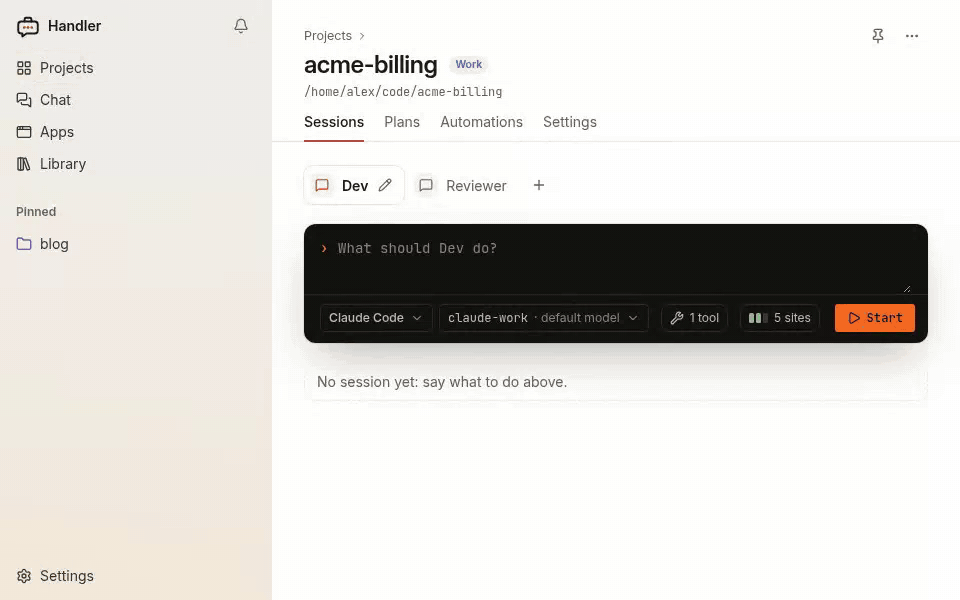
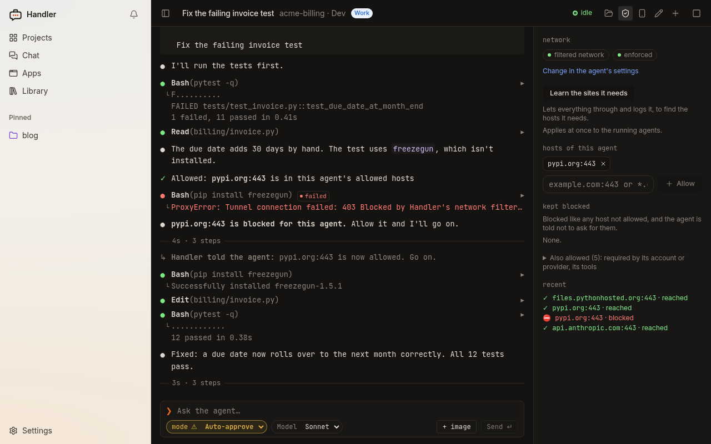
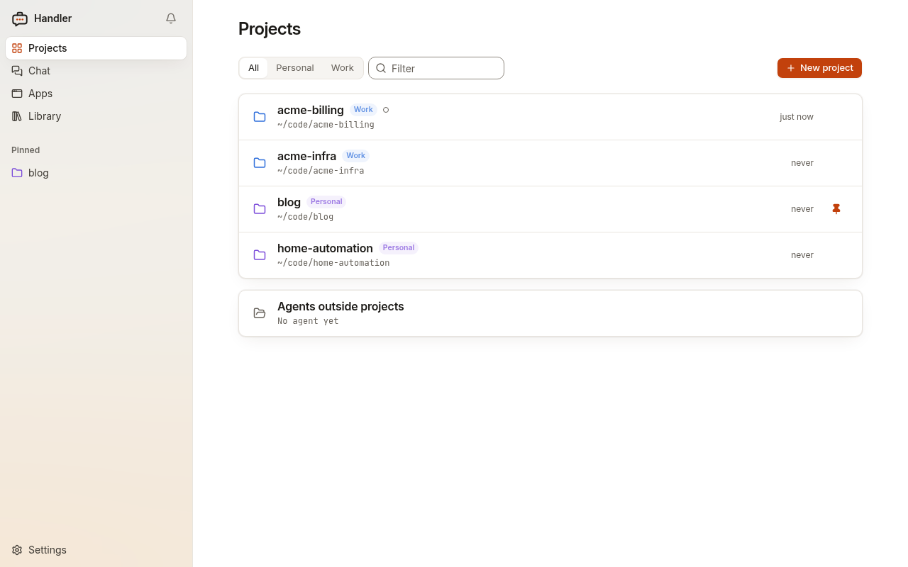
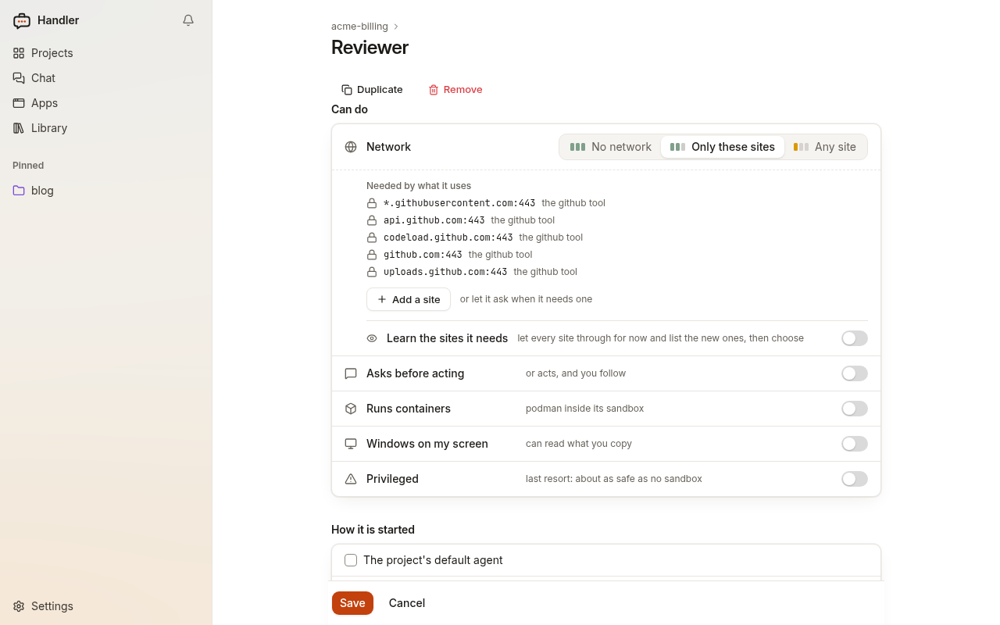
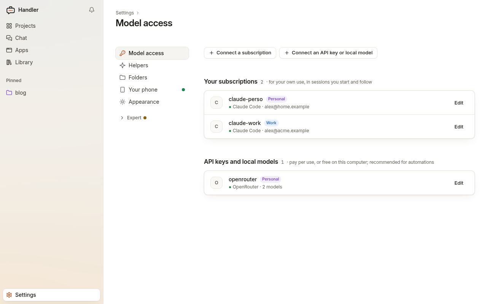
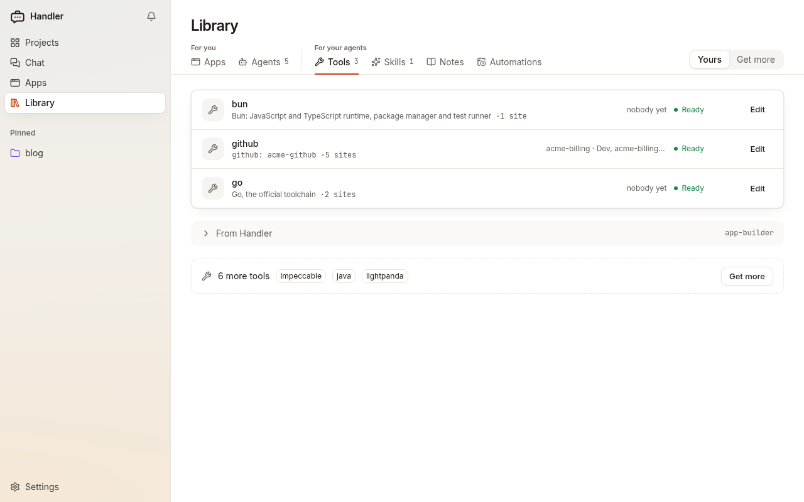
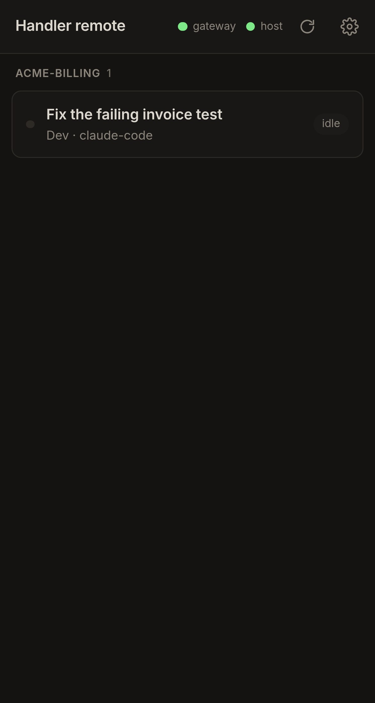
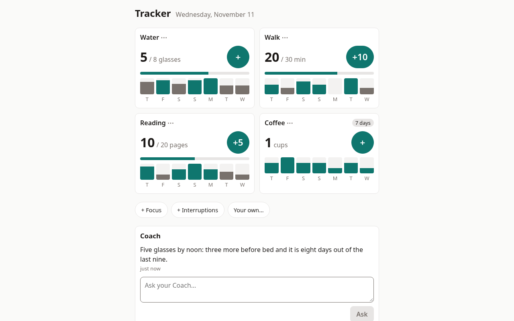

<p align="center">
  <picture>
    <source media="(prefers-color-scheme: dark)" srcset="branding/speech-case-dark.svg">
    
  </picture>
</p>

<h1 align="center">Handler</h1>

<p align="center"><strong>Handler</strong>: every agent needs one.</p>

<p align="center">Your coding agents in a box: each sees one folder, reaches only the hosts you allow, never holds your API keys, and keeps running when you close the tab.</p>

<p align="center">
  <a href="https://github.com/macray/handler-ai/releases">Releases</a> ·
  <a href="https://macray.github.io/handler-ai/">Docs</a> ·
  <a href="CHANGELOG.md">Changelog</a> ·
  <a href="CONTRIBUTING.md">Contributing</a> ·
  <a href="SECURITY.md">Security</a> ·
  <a href="LICENSE">Apache 2.0</a>
</p>

> **Status: alpha · v0.3.0** · Linux supported; macOS and Windows (WSL 2) experimental. Expect
> rough edges, and changes between releases.

<p align="center"></p>

Handler runs Claude Code, Codex, Mistral Vibe or pi on your own machine, on an API key, a local
model, or your own subscription for your own use. One daemon, `handlerd`, starts each session in
a sandbox of its own and keeps it running; you work with it from the web UI, your terminal, your
editor (Zed, over [ACP](https://agentclientprotocol.com), the Agent Client Protocol) or your
phone.

- **One folder.** The agent sees its project folder, read-write. Not your home, `~/.ssh`,
  `~/.aws`, your other projects, nor Handler's own files: it cannot change its own settings.
- **Only the hosts you allow.** Every agent starts with only the sites it needs. A host it is
  refused shows in the session as a card: *Allow for this agent* or *Keep blocked*.
- **Keys kept outside.** A provider's API key or a Claude Code token is a stand-in inside the box;
  the network filter puts the real value only into requests to that key's own hosts.
- **Sessions kept by a daemon.** Close the tab, come back from the terminal or your phone: the
  session is still there.

## Without / with Handler

| Without Handler | With Handler |
|---|---|
| The agent runs in full auto and can read `~/.ssh`, `~/.aws` and your other projects. | It sees its project folder, nothing else. |
| A package it installs can send your API key anywhere. | The key is a stand-in in the box; the real one is added only on requests to the key's own hosts. |
| It needs pypi.org, which you forgot: the run fails, or you open the network to everything. | The blocked host shows as a card while it works, or in your inbox if you were away. One click allows it, for this agent only. |
| Your work account ends up used on a personal project. | Tag projects, accounts and providers Work or Personal: they never cross. |
| You close the tab, and the session is gone. | `handlerd` keeps it; attach from the web, the terminal, Zed or your phone. |
| Long work fills the agent's context, and you type "do the next step" all day. | A plan: steps you approve once, each run in a fresh session, stopping at the first not done. |

## What it does

### A box per session, a network filter per agent

Each session runs in its own container: rootless Podman on Linux and WSL 2 (or Docker), and on a
Mac a virtual machine of its own with Apple's `container` (or a container in Docker Desktop or
OrbStack). The project folder is mounted read-write at the same path; the notes, skills and tools
you give the agent, read-only. The system is read-only too, and caches (`~/.npm`, `~/.cargo`…)
persist between sessions.

Each agent's network is *No network*, *Only these sites* (those it needs and those you allow) or
*Any site*. While you watch a session, the agent's first request to a host you have not decided
on waits up to 8 seconds for your answer; given later, Handler tells the agent ("pypi.org:443 is
now allowed. Go on."). *Learn the sites it needs* lets everything through for a while and lists
what would have been blocked. The session's network panel lists every connection and what
became of it. Changes apply while the agent works.

<p align="center"><a href="docs/screenshots/session-network.png"></a></p>

### Projects, kept apart by area

A project is a folder and its agents. Tag projects, accounts and providers with an area (Work,
Personal, a client): a work account never runs on a personal project, and the other way round.

<p align="center"><a href="docs/screenshots/projects.png"></a></p>

### Agents, one setting per row

An agent is a role on a project, with one goal: who works (an agent
program and its model access), its instructions, its tools, skills and notes, and what it can
do: its network, whether it asks before acting, whether it runs containers. A setting that
weakens the sandbox shows amber and is confirmed when saved. Export some or all of a project's
agents as one file, to set them up in another project or on another computer.

<p align="center"><a href="docs/screenshots/agent-settings.png"></a></p>

### Model access

An API key (Anthropic, OpenAI, Mistral, OpenRouter, any OpenAI-compatible server), a local model
(llama.cpp, Ollama), or your own Claude, ChatGPT or Mistral subscription for your own use. The
sign-in is the vendor's own: you run `claude setup-token` and paste its token, or Handler opens
Codex's or Vibe's own login in a terminal window. A subscription is for sessions you start and
follow; for agents that run unattended, an API key is recommended. Each one says which areas it
may be used for.

<p align="center"><a href="docs/screenshots/model-access.png"></a></p>

### Tools, skills and notes

A **tool** teaches agents one kind of system: the GitHub CLI as one account, a browser, a
toolchain. A **connection** gives it its settings and secrets. Each tool says what it reaches and
what it needs before you install it. **Skills** are `SKILL.md` folders; **notes** are folders of
your files, given read-only. Handler's official source,
[handler-ai-registry](https://github.com/macray/handler-ai-registry), offers tools, agents and
apps; add your own git repositories as sources.

<p align="center"><a href="docs/screenshots/tools.png"></a></p>

### Plans and automations

- **Plans**: long work in steps that an agent writes and you approve once; Handler runs each step
  in a fresh session of that agent and stops at the first one not done.
- **Automations**: *when this happens, run that*. When a session stops, or at a time; run one of
  your agents, or your own script in a box. Results and failed runs come to your inbox, with the
  hosts that were blocked and *Allow and run again*.

### Your phone

Share a session with a phone and follow it, answer it, or start one there. The phone reaches
Handler through a gateway you host (`handler-gateway`, behind HTTPS: Tailscale, or a reverse
proxy on a server); the link is end-to-end encrypted, the gateway can neither read nor forge
messages, and Handler opens no port.

<p align="center"><a href="docs/screenshots/phone-home.jpg"></a></p>

### Early: apps, Ask and Chat

These work, but have little to offer yet.

- **Apps**: small web apps, each in its own sandbox with its own web address and its own agent:
  from a source (the official one offers Tracker and Notes), or one the App creator writes with
  you. An app reaches no network and none of your files unless it asks, which its page shows
  before you deploy it. Open it here or on your phone.
- **Ask**: say what you want, typed or spoken ("I drank 2 glasses of water"), and Handler picks
  which of your apps does it. It does nothing else: no loop, no memory of its own.
- **Chat**: talk with a model about anything, with no folder.

<p align="center"><a href="docs/screenshots/app.png"></a></p>

## Compatibility

| Platform | Status | Agents run in |
|---|---|---|
| Linux | supported | rootless **Podman** with `passt` (default), or a rootful **Docker** Engine (`handler runtime use docker`, newer) |
| Windows (WSL 2) | experimental | Podman in a WSL 2 distribution with systemd on ([install on Windows](docs/windows.md)) |
| macOS 26, Apple silicon | experimental | Apple's **`container`**: a virtual machine per session (default); or Docker Desktop or OrbStack |

| Agent program | Status |
|---|---|
| Claude Code | well tested, used daily |
| Mistral Vibe | well tested, used daily |
| Codex | used once |
| [pi](https://www.npmjs.com/package/@earendil-works/pi-coding-agent) | used once |

Each agent program gets its own image, built on your machine; a rebuild checks the new image
before agents switch to it. Clients: the web UI (`handler ui`), the terminal (`handler run`,
`handler attach`), the agent program's own terminal UI (`handler terminal`), Zed or any ACP
client (`handler acp`), and your phone.

## Install

**You need** Python 3.12 or later (`install.sh` brings it with [uv](https://docs.astral.sh/uv/)),
and a container runtime: on Linux, rootless Podman and `passt`, or Docker (with its buildx
plugin). A systemd user session keeps `handlerd` running; without one, start `handlerd` yourself.
The first `handler setup` asks which agent program you want and builds the toolbox (the system
every agent works in) and that program: **about 1 GB**, from a minute on a fast network to a
quarter of an hour on a slow one. Each other program is built the first time an agent needs it.

### Linux, WSL 2

```bash
curl -fsSL https://github.com/macray/handler-ai/releases/latest/download/install.sh | sh
```

`install.sh` installs uv if you do not have it, then Handler with it, in `~/.local/bin`; it
changes nothing else (read it first: it is attached to each
[release](https://github.com/macray/handler-ai/releases)). With uv already: `uv tool install
handler-ai` (or `pipx install handler-ai`). Then, in a new terminal:

```bash
handler setup   # starts handlerd as a user service, checks this machine, builds the images
handler ui      # opens the web UI
```

Update with `uv tool upgrade handler-ai`. `handler setup` says what your machine is missing, and
can be run again at any time. On Windows: [install on Windows](docs/windows.md), WSL included.
From a checkout: [getting started](docs/getting-started.md#from-a-checkout). Coming from 0.2.0:
some files were renamed and are moved by hand
([upgrading from 0.2.0](docs/configuration.md#upgrading-from-020)).

### macOS (experimental)

Install Apple's [`container`](https://github.com/apple/container/releases) (or Docker Desktop or
OrbStack), then:

```bash
uv tool install handler-ai
container system start   # once, after installing Apple's container
handler setup            # starts handlerd (launchd), asks where agents run, builds the images
handler ui
```

When Docker runs too, `handler setup` asks which one, Apple's `container` first. Change it later
with `handler runtime use` or in Settings → Sandboxes.

## First session

1. **Connect a model.** Settings → Model access: *Connect an API key or local model*, or
   *Connect a subscription* (your own, for your own use).
2. **Create a project.** *New project*, pick a folder, then *Add it* for the agent its page
   offers: it reaches only the sites it needs and never asks before acting; each of its settings
   is yours to change.
3. **Say what to do**, then *Start*. The session keeps running after you close the tab.

Step by step: [getting started](docs/getting-started.md).

## From the terminal

The current folder decides which project's agent runs:

```bash
cd ~/code/my-app
handler run                                         # the project's default agent
handler run reviewer -p "review the last commit"    # the agent named reviewer
handler session list && handler attach s_…          # back to a session, running or stopped
```

To keep typing `claude` as you do today, but in a box and on the account you choose, put a shell
function in `~/.bashrc` (`~/.zshrc` on a Mac); it works for Claude Code and Mistral Vibe:

```bash
claude() { handler terminal claude-perso -- "$@"; }
```

More: [`handler terminal`](docs/cli/terminal.md), [every command](docs/cli/index.md).

## How it works

```
 web UI · handler CLI · editor (handler acp) · phone
              │  HTTP + WebSocket (ACP)
              ▼
          handlerd ── projects, agents, sessions, apps; checks every message to and from the agent
              │
              ▼
   ┌─ rootless Podman · Mac: Apple container, Docker ─┐
   │  agent container            network filter       │
   │  Claude Code / Codex / …  ──► allowed hosts only │
   │  project folder (rw), nothing else               │
   └──────────────────────────────────────────────────┘
```

Every message between a client and an agent passes through `handlerd` and is checked. The
network filter is a per-agent allow-list proxy, which also puts the real API keys in.
Configuration is plain files in `~/.config/handler-ai/`.

| Word | Meaning |
|---|---|
| **Model access** | An **account** (a subscription) or a **provider** (an API key, a local server). |
| **Project** | A folder and its agents. |
| **Area** | What a project is for (Work, Personal, a client); each account and provider says which areas it may be used for. |
| **Agent** | A role on a project: who works, its instructions, tools, and what it can do. |
| **Session** | One conversation with an agent, in its own sandbox, kept by the daemon. |
| **Agent program** | The coding agent an agent runs: Claude Code, Codex, Mistral Vibe or pi. |
| **Toolbox** | The system every agent works in (Fedora with git, Python, Node…), which the agent programs' images are built on. |
| **Network filter** | What lets an agent's requests through to the hosts it may reach and blocks the rest. |
| **Tool / connection** | A package teaching agents one kind of system / its settings and secrets. |
| **Source** | A git repository that offers apps, agents and tools to install. |

More: [concepts](docs/concepts.md).

## Security model

A rootless container shares your computer's kernel: it is not a virtual machine (except with
Apple's `container`, where each session is one).

**Protects**: the rest of your computer (only the project folder is writable; never Handler's own
files); your network (a per-agent allow-list, changed live, blocked hosts shown); Claude Code
tokens and providers' API keys (stand-ins; the real values only towards their hosts); your
settings (only you change them); your phone link (no open port, end-to-end encrypted).

**Does not protect**: the folder itself (an agent can change or delete anything in it: use git);
what allowed hosts receive (keep allow-lists short); other secrets (a ChatGPT or Mistral login
file, tools' secrets can be read in the box); what the agent says or writes (review its changes
before you commit, deploy or run them).

Details: [security](docs/security.md); to report a problem: [`SECURITY.md`](SECURITY.md).

## Limitations

- macOS is experimental. With Apple's `container`: no agents that run containers, no privileged
  agents, no windows on your screen. With Docker Desktop or OrbStack: no apps, no windows on
  your screen.
- Containers share a kernel: your computer's on Linux, Docker's virtual machine's with Docker
  Desktop. Only Apple's `container` gives each session a virtual machine.
- Only Claude Code tokens and providers' API keys are replaced by stand-ins.
- Codex has no "ask before every edit" mode; pi never asks.
- Phone access needs a gateway you host, behind HTTPS.
- Windows on your screen (an agent's browser on your desktop) need a Wayland session.

The rest: [known limitations](docs/known-limitations.md).

## How it compares

Other tools sandbox coding agents too. Where Handler differs, as of November 2026 (check each
project's own docs):

| | Handler | Claude Code's `/sandbox`, Codex's sandbox | Docker Sandboxes (`sbx`) | A devcontainer or VM you set up |
|---|---|---|---|---|
| What is isolated | the whole agent program | the commands it runs (the agent itself runs on your machine) | the whole agent program | the whole agent program |
| Isolation | rootless container (shares your kernel); on a Mac, a VM per session with Apple's `container` | OS sandbox (bubblewrap, Landlock, Seatbelt) | microVM (its own kernel): stronger | as you set it up |
| Agent programs | Claude Code, Codex, Vibe, pi | one each | several | any |
| Network | per-agent allow-list, changed live | allow-list | deny by default, allow-list | as you set it up |
| API keys | stand-in in the sandbox | in the agent's environment | injected by a proxy | in the environment |
| Sessions | kept by a daemon: browser, terminal, editor, phone | the agent program's own | the agent program's own | the agent program's own |

Pick Handler if you use more than one agent program and want one place to see and control what
every agent reaches. Pick a microVM if you need stronger isolation.

**What Handler is not**: a hosted platform (nothing runs on our servers: there are none), an
orchestrator of agent teams, a pipeline engine, an always-on assistant, or a memory engine (notes
are plain files).

## Documentation

- [Documentation website](https://macray.github.io/handler-ai/)
- [Changelog](CHANGELOG.md)

## Feedback and contributing

Pull requests are unlikely to be merged: Handler is written mostly with coding agents, by one
person who has to keep understanding all of it. What helps is an
[issue](https://github.com/macray/handler-ai/issues/new/choose) describing the problem: what you
tried, where it failed, what you do by hand today. An idea that fits is built in a later release,
and the release notes say whose idea it was ([`CONTRIBUTING.md`](CONTRIBUTING.md)). A security
problem: [`SECURITY.md`](SECURITY.md).

## License

Apache 2.0, see [`LICENSE`](LICENSE).
